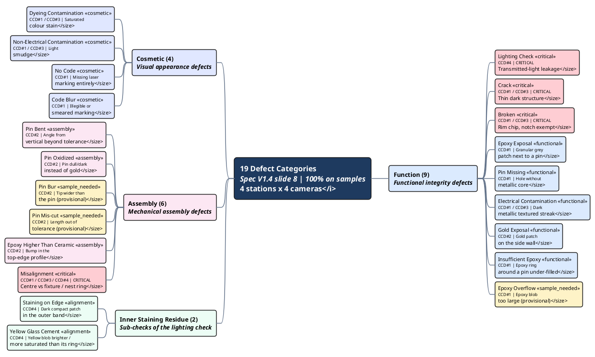

# CSE Defect Classification Taxonomy

## Legend

| Marker | Meaning |
|:-------|:--------|
| Red background | CRITICAL defect -- zero tolerance, immediate reject |
| Yellow background | No real sample in the V1.4 testing report -- thresholds marked `provisional` |
| Blue background | Function group defect |
| Purple background | Cosmetic group defect |
| Pink background | Assembly group defect |
| Green background | Inner staining residue (lighting-check sub-checks) |

## CCD Assignment Summary

| Camera | Defects Detected | Count |
|:-------|:----------------|------:|
| CCD#1 (Top) | Crack, Broken, Misalignment, Pin Missing, Insufficient Epoxy, Epoxy Overflow, Epoxy Exposal, Dyeing / Electrical / Non-Electrical Contamination, No Code, Code Blur | 12 |
| CCD#2 (Side) | Pin Bent, Pin Oxidized, Pin Bur, Pin Mis-cut, Gold Exposal, Epoxy Higher Than Ceramic | 6 |
| CCD#3 (Bottom) | Crack, Broken, Misalignment, Dyeing / Electrical / Non-Electrical Contamination | 6 |
| CCD#4 (Inner check) | Lighting Check, Staining on Edge, Yellow Glass Cement, Misalignment (nest ring) | 4 |
